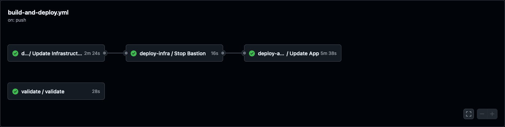

# DevOps Documentation

## Table of Contents

- [DevOps Documentation](#devops-documentation)
  - [Table of Contents](#table-of-contents)
  - [Prerequisites](#prerequisites)
    - [Administrative](#administrative)
    - [Application](#application)
    - [Data](#data)
    - [Software](#software)
      - [Debian/Ubuntu](#debianubuntu)
      - [MacOS](#macos)
  - [Configurations](#configurations)
    - [CI/CD](#cicd)
      - [`.github/workflows/*`](#githubworkflows)
      - [Deployment](#deployment)
        - [`build-and-deploy.yml`](#build-and-deployyml)
          - [`validation-run.yml`](#validation-runyml)
          - [`terraform-deploy-infra.yml`](#terraform-deploy-infrayml)
          - [`cloudgov-deploy-app.yml`](#cloudgov-deploy-appyml)
      - [Validation](#validation)
        - [`validation.yml`](#validationyml)
      - [Scheduled Pipelines](#scheduled-pipelines)
        - [`daily-backup.yml`](#daily-backupyml)
        - [`generate-static-run-*.yml`](#generate-static-run-yml)
      - [Manual Pipelines](#manual-pipelines)
        - [`downsync.yml`](#downsyncyml)
        - [`database-restore.yml`](#database-restoreyml)
        - [`files-restore.yml`](#files-restoreyml)
        - [`database-backup-dev.yml`](#database-backup-devyml)
      - [Repository variables](#repository-variables)
    - [CloudFoundry](#cloudfoundry)
      - [apt.yml](#aptyml)
      - [manifest.yml](#manifestyml)
      - [.bp-config/](#bp-config)
  - [Scripts](#scripts)
    - [Application Scripts](#application-scripts)
    - [Orchestration Scripts](#orchestration-scripts)
    - [Pipeline Scripts](#pipeline-scripts)
    - [Developer Scripts](#developer-scripts)

## Prerequisites

These are the access, data and tools needed to work with the Cloud.gov environments and run the scripts in this repository.

### Administrative

- Cloud.gov spaces

  The project's Cloud.gov organization has three spaces: `dev`, `staging` and `prod`. Apps and services in them are named `digital-gov-<name>-<space>`, for example `digital-gov-drupal-staging` or `digital-gov-backup-prod`.

  Each space is deployed from these branches:

  | Branch | Space |
  | --- | --- |
  | `develop`, `feature/DIGITAL-*-deploydev` | `dev` |
  | `stage`, `release/*`, `hotfix/*`, `feature/DIGITAL-*-deploystaging` | `staging` |
  | `main` | `prod` |

- Cloud.gov access

  Running scripts against a space from your computer needs a Cloud.gov account with access to that space. The pipeline's service account has the Space Developer role in each space.

### Application

Clone the [application](https://github.com/GSA/digital-gov-drupal).

### Data

Each space has a backup bucket, the `digital-gov-backup-<space>` S3 service:

- Database dumps: `latest.sql.gz`, plus dated copies under `YYYY/MM/DD/`.
- Public files: `storage/latest.tar.gz`, plus dated copies under `storage/YYYY/MM/DD/`.
- The generated static site: `static/latest.tar.gz`, plus dated copies under `static/YYYY/MM/DD/`.

Production is backed up nightly by [`daily-backup.yml`](#daily-backupyml). The other spaces only have the backups taken by a [downsync](#downsyncyml) or by hand.

To load a backup into your local site, see [Refreshing your local from Cloud.gov](backend.md#refreshing-your-local-from-cloudgov). To copy one space's data into another, see [`downsync.yml`](#downsyncyml).

### Software

#### Debian/Ubuntu

[[top]](#devops-documentation)

- awscli

  [Instructions](https://docs.aws.amazon.com/cli/latest/userguide/getting-started-install.html)

  ```bash
  curl "https://awscli.amazonaws.com/awscli-exe-linux-x86_64.zip" -o "awscliv2.zip"
  unzip awscliv2.zip
  sudo ./aws/install
  ```

- CloudFoundry CLI v8, with the `cf-service-connect` plugin (needed for database tunnels)

  [Instructions](https://docs.cloudfoundry.org/cf-cli/install-go-cli.html)

  ```bash
  wget -q -O - https://packages.cloudfoundry.org/debian/cli.cloudfoundry.org.key | sudo apt-key add -
  echo "deb https://packages.cloudfoundry.org/debian stable main" | sudo tee /etc/apt/sources.list.d/cloudfoundry-cli.list
  sudo apt-get update
  sudo apt-get install cf8-cli
  cf install-plugin https://github.com/cloud-gov/cf-service-connect/releases/download/v1.1.4/cf-service-connect_linux_amd64
  ```

- jq

  ```bash
  sudo apt install jq
  ```

- mysql-client (for `scripts/downsync.sh`)

  ```bash
  sudo apt-get install mysql-client
  ```

- OpenTofu (only for the bootstrap in [Disaster Recovery](disasterrecovery.md); deployments run it on the Terraform bastion)

  [Instructions](https://opentofu.org/docs/intro/install/deb/)

  ```bash
  # Download the installer script:
  curl --proto '=https' --tlsv1.2 -fsSL https://get.opentofu.org/install-opentofu.sh -o install-opentofu.sh
  # Alternatively: wget --secure-protocol=TLSv1_2 --https-only https://get.opentofu.org/install-opentofu.sh -O install-opentofu.sh

  # Give it execution permissions:
  chmod +x install-opentofu.sh

  # Please inspect the downloaded script

  # Run the installer:
  ./install-opentofu.sh --install-method deb

  # Remove the installer:
  rm -f install-opentofu.sh
  ```

[[top]](#devops-documentation)

#### MacOS

- Homebrew

  [Instructions](https://brew.sh)

  ```bash
  /bin/bash -c "$(curl -fsSL https://raw.githubusercontent.com/Homebrew/install/HEAD/install.sh)"
  ```

  NOTE: `sudo` rights are needed on the laptop to install `homebrew`, otherwise permissions will be incorrect.

- awscli

  [Instructions](https://docs.aws.amazon.com/cli/latest/userguide/getting-started-install.html)

  ```bash
  brew install awscli
  ```

- CloudFoundry CLI v8, with the `cf-service-connect` plugin (needed for database tunnels)

  [Instructions](https://docs.cloudfoundry.org/cf-cli/install-go-cli.html)

  ```bash
  brew install cloudfoundry/tap/cf-cli@8
  # Apple silicon; on an Intel Mac use cf-service-connect_darwin_amd64.
  cf install-plugin https://github.com/cloud-gov/cf-service-connect/releases/download/v1.1.4/cf-service-connect_darwin_arm64
  ```

- coreutils (only `scripts/download_backup.sh` checks for it)

  ```bash
  brew install coreutils
  ```

- jq

  ```bash
  brew install jq
  ```

- mysql-client (for `scripts/downsync.sh`)

  Homebrew doesn't put it on your `PATH`, so add it:

  ```bash
  brew install mysql-client
  echo 'export PATH="$(brew --prefix mysql-client)/bin:$PATH"' >> ~/.zshrc
  ```

- OpenTofu (only for the bootstrap in [Disaster Recovery](disasterrecovery.md))

  [Instructions](https://opentofu.org/docs/intro/install/homebrew/)

  ```bash
  brew install opentofu
  ```

## Configurations

[[top]](#devops-documentation)

### CI/CD

This repository uses GitHub Actions as its CI/CD pipeline. Step-by-step runbooks for many of the workflows and scripts are in [runbooks/](runbooks/).

#### `.github/workflows/*`

These files contain the GitHub Actions `jobs` and `workflows` that make up the CI/CD pipeline. View [Understanding GitHub Actions](https://docs.github.com/en/actions/about-github-actions/understanding-github-actions) to learn more.

Scheduled workflows run from the default branch, `develop`.

#### Deployment

The following are the workflows for deployments.

***NOTE: OpenTofu is used instead of Terraform due to the license changes to Terraform in 2024.  When Terraform is being mentioned, this project uses OpenTofu.***

##### `build-and-deploy.yml`

Runs on every push to a branch in the [table above](#administrative), and deploys that branch to its space. It calls the three workflows below in order. Only one deployment runs at a time, across all branches.



###### `validation-run.yml`

Called by `build-and-deploy.yml` and by [`validation.yml`](#validationyml). Installs Composer dependencies and runs `robo validate:all`.

###### `terraform-deploy-infra.yml`

Called by `build-and-deploy.yml`. Applies the Terraform in `terraform/infra` to the space, through the Terraform bastion in `prod`:

- `updateInfrastructure`
  1. Clone the repository and work out the space from the branch.
  1. Install dependencies (apt packages and the CloudFoundry CLI).
  1. Log in to Cloud.gov and start the Terraform bastion, with SSH enabled.
  1. Clone the branch onto the bastion.
  1. Build the ModSecurity module for the WAF's NGINX version on the GitHub runner, with Docker, and copy it to the bastion.
  1. Generate `terraform.tfvars` from `terraform.tfvars.tmpl` and copy it to the bastion.
  1. On the bastion, run `tofu init` (creating a workspace named after the space if needed), then `tofu validate`, `tofu plan` and `tofu apply -auto-approve`.
- `stopBastion`
  1. Stop the Terraform bastion and disable SSH again.

###### `cloudgov-deploy-app.yml`

Called by `build-and-deploy.yml`. Deploys Drupal to the space:

- `updateApp`
  1. Clone the repository and set the space, memory and instance count from the branch. Outside prod, Composer dev dependencies are installed too.
  1. Install dependencies, Node 24 and the CloudFoundry CLI, and log in to Cloud.gov.
  1. Build the theme with `orch/build_node.sh`.
  1. Clear the buildpack cache and deploy the app with `cloud-gov-deploy.sh`.
  1. Run the post deploy steps with `cloud-gov-post-deploy.sh`. A space listed in the `INSTALL_DRUPAL_SPACES` variable is reinstalled from scratch on every deploy; every other space gets `drush deploy`.
  1. If the space is listed in `GENERATE_STATIC_SITE_ON_DEPLOY_SPACES`, regenerate the static site.

#### Validation

##### `validation.yml`

Runs [`validation-run.yml`](#validation-runyml) on every pull request and on pushes to `feature/**` branches.

#### Scheduled Pipelines

##### `daily-backup.yml`

Backs up production every day at 06:00 UTC, into the `digital-gov-backup-prod` bucket (see [Data](#data)):

- `startBastion`: start the database backup bastion.
- `backup-database`: tunnel to the database through the bastion and back it up with `database-backup.sh`.
- `stopBastion`: stop the bastion.
- `backup-files`: back up the public files (storage) and static site buckets with `files-backup.sh`.

##### `generate-static-run-*.yml`

`generate-static-run-dev.yml`, `-stage.yml` and `-prod.yml` run hourly, at 15, 30 and 45 minutes past the hour. Each calls `generate-static.yml` for its space, which regenerates the static site (`scripts/upkeep`) if the space is listed in the `GENERATE_STATIC_SITE_ON_CRON_SPACES` variable.

#### Manual Pipelines

Run these from the Actions tab.

##### `downsync.yml`

Overwrites one space's database and public files with another's, usually to refresh `staging` or `dev` from `prod`. Upward syncs and syncs into prod need a separate confirmation. It runs `scripts/downsync.sh`, which can also be run from your computer. See the [runbook](runbooks/github/downsync.yml.MD).

##### `database-restore.yml`

Restores a space's database from its own backup bucket, then runs the post deploy steps. The space comes from the branch it's run on, so running it on `main` restores prod. `database-restore-dev.yml` is an identical copy; both show up in Actions as "Database Restore".

##### `files-restore.yml`

Restores a space's public files and/or static site from its own backup bucket. The space comes from the branch it's run on.

##### `database-backup-dev.yml`

A copy of the database part of `daily-backup.yml` for `dev`. It has no schedule and nothing calls it, so it never runs.

#### Repository variables

The workflows read these GitHub Actions variables (Settings → Secrets and variables → Actions → Variables):

| Variable | Used by | Purpose |
| --- | --- | --- |
| `INSTALL_DRUPAL_SPACES` | `cloudgov-deploy-app.yml`, `downsync.yml` | Comma-separated spaces that are reinstalled from scratch on every deploy. Downsync refuses to copy into a space listed here. |
| `GENERATE_STATIC_SITE_ON_DEPLOY_SPACES` | `cloudgov-deploy-app.yml` | Spaces whose static site is regenerated after each deploy. |
| `GENERATE_STATIC_SITE_ON_CRON_SPACES` | `generate-static.yml` | Spaces whose static site is regenerated hourly. |
| `DEVELOP_CMS_MEMORY`, `STAGE_CMS_MEMORY`, `MAIN_CMS_MEMORY` | `cloudgov-deploy-app.yml` | Drupal app memory, per space. |
| `DEVELOP_INSTANCES`, `STAGE_INSTANCES`, `MAIN_INSTANCES` | `cloudgov-deploy-app.yml` | Drupal app instance count, per space. |
| `DEV_CMS_URL`, `STAGING_CMS_URL`, `PROD_CMS_URL`, `DEV_STATIC_URL`, `STAGING_STATIC_URL`, `PROD_STATIC_URL` | `cloudgov-deploy-app.yml` | The CMS and static site URLs, per space. |
| `BUILDPACK_PORT` | `cloudgov-deploy-app.yml` | The port the WAF reaches the Drupal app on (its network policies). |
| `UBUNTU_VERSION`, `MODSECURITY_NGINX_VERSION` | `terraform-deploy-infra.yml` | Used to build the WAF's ModSecurity module. |

[[top]](#devops-documentation)

### CloudFoundry

#### apt.yml

This yaml is read by the [apt buildpack](https://github.com/cloudfoundry/apt-buildpack) during the CloudFoundry staging process. It allows the installation of additional packages from Debian and Ubuntu repositories before the application is deployed.

In this repository, it installs the NewRelic PHP agent (`newrelic-php5`, from NewRelic's apt repository), `mysql-client-core-8.0` and `bsdmainutils`.

#### manifest.yml

The configuration for the Drupal app, `digital-gov-drupal-<space>`. It uses the apt buildpack and the [php buildpack](https://github.com/cloudfoundry/php-buildpack), pinned to `v4.6.28`. The app has only an internal route; traffic reaches it through the WAF. It binds the space's `mysql`, `secrets`, `static` and `storage` services. `cloud-gov-deploy.sh` fills in its variables and binds the `cache` service when it exists.

#### .bp-config/

This directory has additional configuration settings for the [php buildpack](https://github.com/cloudfoundry/php-buildpack).

- `httpd/httpd.conf`: overrides the buildpack's Apache configuration. It includes the files in `httpd/user-provided/`.
- `httpd/user-provided/httpd-drupalsupport.conf`: loads `mod_proxy_http`, which the s3fs module needs.
- `php/fpm.d/stdout.conf`: sends PHP-FPM worker output to the app's log.
- `php/php.ini.d/extensions.ini`: loads the PHP extensions the site needs: apcu, igbinary, imagick, pdo_mysql, redis, sodium and zip, plus opcache. To find additional modules that are supported, [check this file](https://github.com/cloudfoundry/php-buildpack/blob/master/manifest.yml). Scroll down to the version of PHP you are utilizing, and look for the `dependencies` section.
- `php/php.ini.d/memory_limit.ini`: sets PHP's `memory_limit` to 512M.
- `options.json`: bootstrapping options for the php buildpack.
  - `PHP_VERSION`: `{PHP_83_LATEST}`. For valid values, [check this file](https://github.com/cloudfoundry/php-buildpack/blob/master/defaults/options.json).
  - `COMPOSER_INSTALL_OPTIONS`: options for the buildpack's `composer install`. `cloudgov-deploy-app.yml` removes `--no-dev` outside prod.
  - `WEBDIR` and `COMPOSER_VENDOR_DIR`: `web` and `vendor`.
  - `ADDITIONAL_PREPROCESS_CMDS`: commands run each time an instance starts, before the app. Currently, this runs [bootstrap.sh](#application-scripts).

## Scripts

[[top]](#devops-documentation)

### Application Scripts

These are in `scripts/` and run in the Drupal app's container on Cloud.gov.

| Script | What it does |
| --- | --- |
| `bootstrap.sh` | Runs as each instance starts (see `options.json`). Configures the NewRelic agent, exports variables from `bash_exports.sh`, creates the files directories, and installs `awscli`. |
| `bash_exports.sh` | Exports the app's settings (database, S3, space and host names) from Cloud.gov's `VCAP_*` variables. Sourced by `bootstrap.sh`. |
| `post-deploy` | Runs `orch/deploy.sh`. Run over `cf ssh` by `cloud-gov-post-deploy.sh`. |
| `upkeep` | Regenerates the static site with Drupal's Tome module and syncs it to the space's `static` bucket. Runs as a Cloud.gov task, started by `pipeline_wrapper.sh` or `downsync.sh`. |
| `start`, `entrypoint` | Not used. Nothing runs them; the php buildpack starts PHP and Apache. |

### Orchestration Scripts

These are in `orch/`. They're shared by Lando and Cloud.gov.

| Script | What it does |
| --- | --- |
| `build.sh` | Runs `composer install`. Used by Lando only; on Cloud.gov the php buildpack installs Composer dependencies. |
| `build_node.sh` | Builds the custom themes with npm and gulp. Used by `cloudgov-deploy-app.yml` and Lando. |
| `deploy.sh` | Runs `deploy_update.sh` or `deploy_install.sh`, depending on `DRUPAL_UPDATE_OR_INSTALL`. |
| `deploy_update.sh` | Runs `drush deploy` (update hooks and config import) with the site in maintenance mode. Installs instead if Drupal isn't installed. |
| `deploy_install.sh` | Reinstalls Drupal from the exported configuration (`drush site:install --existing-config`), then copies the public files it created to S3 and sets the homepage. |
| `post_deploy.sh` | Runs cron and reindexes Search API. Used by Lando only. |
| `show_file.sh` | Prints the start and end banners the other scripts use. |

### Pipeline Scripts

These are in `scripts/pipeline/`, and are run by the workflows.

| Script | What it does |
| --- | --- |
| `cloud-gov-login.sh` | Logs in to a Cloud.gov organization and space with the pipeline's credentials. |
| `cloud-gov-deploy.sh` | Deploys the Drupal app from `manifest.yml`, filling in its variables with `envsubst`. Then it binds the cache service, sets up network policies between the WAF and Drupal, and maps the routes. |
| `cloud-gov-post-deploy.sh` | Waits for the app, then runs `scripts/post-deploy` over `cf ssh`, as an install or an update depending on `INSTALL_DRUPAL_SPACES`. On prod it turns SSH on for this and off again after. A failure here doesn't fail the workflow. |
| `cloud-gov-post-sync.sh` | Run after a downsync: `drush deploy`, then rebuilds s3fs's record of the files in the bucket. Unlike post deploy, a failure fails the run. |
| `cloud-gov-remote-command.sh` | Runs a command on an app over SSH. Equivalent of `ssh USER@HOST 'COMMAND'`. Used for the Terraform bastion. |
| `cloud-gov-scp-file.sh` | Copies a file or directory to an app over SSH. Used for the Terraform bastion. |
| `cloud-gov-waf-version.sh` | Sets the NGINX version the WAF's ModSecurity module is built for. |
| `cloud-gov-wait-for-app-start.sh` | Waits until an app's first instance is running. |
| `pipeline_wrapper.sh` | Runs a script from `scripts/` (in practice `upkeep`) as a Cloud.gov task on the Drupal app, and shows its log. |
| `terraform-build-waf-plugin.sh` | Builds the WAF's ModSecurity module with Docker and copies it to the Terraform bastion. |
| `database-backup.sh` | Dumps a space's database through its bastion and uploads it to the space's backup bucket. |
| `database-restore.sh` | Replaces a space's database with a downloaded dump, through its bastion. Refuses a truncated dump. |
| `s3-backup-download.sh` | Downloads a database dump from a space's backup bucket, or another space's (`BACKUP_SPACE`). |
| `files-backup.sh` | Archives a space's storage (public files) or static bucket into its backup bucket. |
| `files-restore.sh` | Restores a storage or static archive from a backup bucket into a space's bucket. |
| `s3-credentials.sh` | Creates and deletes the temporary S3 credentials the files scripts use. |
| `downsync-preflight.sh` | Checks a downsync's spaces and confirmation before anything changes. |
| `deb-awscli.sh`, `deb-basic-deps.sh`, `deb-cf-install.sh`, `deb-mysql-client-install.sh` | Install the AWS CLI; `curl` and `gettext` (for `envsubst`); the CloudFoundry CLI and `cf-service-connect` plugin; and the MySQL client, on the GitHub runner. |
| `build-theme.sh` | Not used. It builds a theme directory that no longer exists; `orch/build_node.sh` builds the theme. |

### Developer Scripts

These are in `scripts/`, and run on your computer. Log in to Cloud.gov first with `cf login -a api.fr.cloud.gov --sso`.

| Script | What it does |
| --- | --- |
| `downsync.sh` | Overwrites one space's database and public files with another's. Run with `-h` for options. See the [runbook](runbooks/github/downsync.yml.MD). |
| `refresh-local.sh` | Loads a space's database and public files into your local Lando site. See [Refreshing your local from Cloud.gov](backend.md#refreshing-your-local-from-cloudgov). |
| `download_files.sh`, `download_static.sh` | Download a space's public files or static site backup. `download_files_common.sh` holds what they share. |
| `download_backup.sh` | Downloads a database backup by name from a bucket. Dated backups are stored under `YYYY/MM/DD/`, so only `-d latest` finds one; `refresh-local.sh` covers the same ground. |
| `cloud-gov-s3-creds.sh` | Creates temporary credentials for an S3 service and exports them for the AWS CLI; `-d` deletes them. |
| `delete-workflow-run-logs.sh` | Deletes GitHub Actions run logs in bulk. Needs the `gh` CLI. |
| `audit/deps-check`, `audit/deps-update` | Report on, and then apply, Composer and npm dependency updates. |

[[top]](#devops-documentation)
